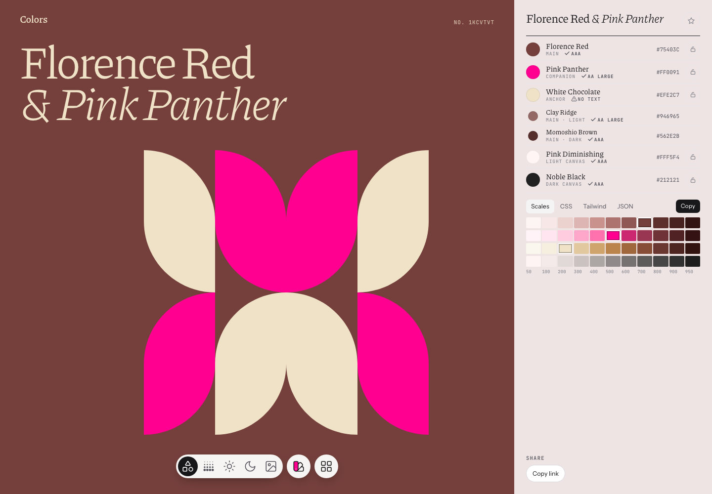

# Colors

A palette generator for interfaces. Browse colors as artwork, gradients, and
light or dark UI previews, then export the palette for your own project.

[Try the live demo](https://colors.gnass.buzz)



- Generate five-color palettes from a statistical model of editorial color combinations.
- Explore one or two hue families, monochrome palettes, and neon accents.
- Preview your own SVG in each palette, and save favorites to a shortlist.
- Export CSS variables, Tailwind v4 themes, or JSON with color scales and UI tokens.
- Share palettes with links and image previews. Enable accessible tokens to adjust UI contrast.

## Run locally

Use **Node.js 24 or newer** and npm. With nvm, run `nvm use` first.

```sh
npm ci
npm run dev
```

Open the URL printed by Vite, normally `http://localhost:5173`.
No accounts or API keys are needed to run the app.

## Development

```sh
npm test                 # deterministic generation, link round trips, contrast, clipboard
npm run build            # type-check client and server, then build the app
npx playwright install chromium
npm run test:browser     # SVG isolation, imports, shared links, and shortlist restoration
```

GitHub Actions runs the tests, production build, and Chromium checks on pushes
and pull requests.

Generated data is checked in, so these commands are only needed when changing
its sources:

```sh
npm run fit              # refit src/core/params.ts from data/; requires uv
npm run shapes           # rebuild src/shapes.ts from data/shapes/
npm run names            # rebuild public/colornames.txt from data/names/
npm run screenshot       # refresh the README image; requires Playwright Chromium
```

## Deploy

The app uses Cloudflare Pages. Its functions add Open Graph metadata and render
palette preview images for shared links.

```sh
npm run pages            # build and run locally with Pages Functions on :8796
npm run deploy           # build and deploy using your Cloudflare account
```

Vite's preview command serves the client build only. Use `npm run pages` when
checking shared-link metadata and `/og/<key>.png` images. Deployment requires
Cloudflare authentication and a Pages project; review `wrangler.toml` for your setup.

## Explore the code

The generator is framework-free TypeScript. The browser app uses DOM APIs and
CSS; Pages Functions render social images with resvg.

| Path | Responsibility |
| --- | --- |
| [`src/core/`](src/core/) | Color math, statistical sampling, ramps, gradients, and tokens |
| [`src/app/entry.ts`](src/app/entry.ts) | Build a complete entry from explicit generation settings |
| [`src/app/storage.ts`](src/app/storage.ts) | Persistence and compatibility with older saved keys |
| [`src/app/ui.ts`](src/app/ui.ts) | Light and dark interface preview templates |
| [`src/app/swipe.ts`](src/app/swipe.ts) | Pointer, wheel, and keyboard navigation transitions |
| [`src/main.ts`](src/main.ts) | App state, screens, and interaction wiring |
| [`src/link.ts`](src/link.ts) | Shared-palette keys and deterministic generation |
| [`src/svg.ts`](src/svg.ts) | Isolated SVG analysis and recoloring |
| [`functions/`](functions/) | Shared-page metadata and PNG previews |
| [`data/`](data/) / [`scripts/`](scripts/) | Model inputs and asset generation |

Read the [usage guide](docs/usage.md), [model explanation](docs/model.md), or
[rule-by-rule walkthrough](docs/algorithm.html). The walkthrough works locally
at `/docs/algorithm.html` with `npm run dev`.

## Credits

- Tile shapes: [SVG Shapes](https://www.shapes.gallery) by Monika Michalczyk.
- Icons: shapes, sun, moon, image, swatch book and grid from [Lucide](https://lucide.dev) (ISC).
- Color names: [meodai/color-names](https://github.com/meodai/color-names) (MIT); filtered with the English list of [Many Languages, Many Colors](https://github.com/meodai/many-languages-many-colors-dataset-lists) (MIT).

## License

The original project code is [MIT licensed](LICENSE). Third-party assets retain
their own terms; see [third-party notices](THIRD_PARTY_NOTICES.md), [color-name sources](data/names/README.md),
and [Piazzolla's font license](public/fonts/Piazzolla-OFL.txt).
